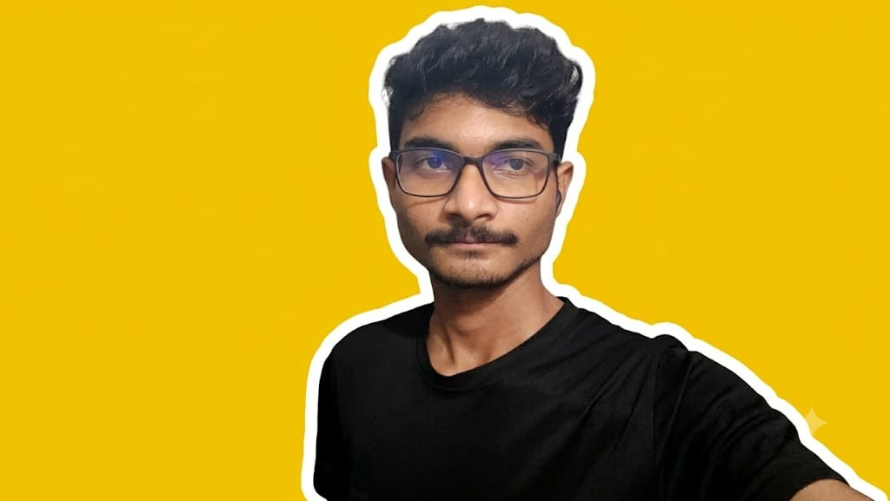

# 3D Engineering Portfolio — Abhiram Vaddi

> Production-grade 3D mechanical engineering and embedded systems portfolio built with React (Vite), Tailwind CSS, Framer Motion, and React Three Fiber.



## 👤 Profile
- **Name:** Abhiram Vaddi
- **Degree:** B.Tech in Mechanical Engineering
- **Institution:** Ramachandra College of Engineering (Autonomous), Eluru, AP, India
- **CGPA:** 7.43
- **Focus:** Mechatronics, Embedded Firmware (ESP32 / FreeRTOS), Robotics, Parametric 3D CAD (SolidWorks), and UAV Systems
- **LinkedIn:** [Abhiram Vaddi](https://www.linkedin.com/in/abhiram-vaddi-4bb285366)
- **GitHub:** [abhiram2711](https://github.com/abhiram2711)

---

## 🚀 Key Projects

1. **AeroThermal Edge**
   - *1st Prize Winner, Rashtriya Innovation Challenge (RIC 2026)*
   - Dual-core ESP32-S3 search-and-rescue UAV payload with AMG8833 thermal array and Webots simulation.
   - Team: Vaddi Abhiram & Tangala Kumar Babu.

2. **Smart RC Multi-Mode Robot – Mark 2**
   - ESP32-powered differential 4WD robot with Bluetooth SPP, non-blocking ultrasonic state machine, and real-time OLED telemetry.

3. **Autonomous Obstacle-Avoidance Robot – Mark 1**
   - Arduino UNO ground rover with dedicated power rail isolation, star grounding, and H-bridge motor driver diagnostics.

4. **Go-Kart GPS Telemetry & Lap Timing System**
   - High-rate u-blox GNSS timing computer with 2D computational geometry virtual finish gate crossing and ESP32 SoftAP web server.

5. **Smart Electricity Monitor – Embedded Fusion**
   - Prakalp 24-Hour Hackathon project. Non-invasive True RMS energy node with SCT-013 split-core CT sensor and DC bias network.

6. **Desk Companion "Buddy"**
   - Tactile single-button state machine on ESP32 driving SSD1306 OLED mood face, clock, Pomodoro, and reflex game.

---

## 🛠️ CAD & Prototyping
- **SolidWorks:** Parametric spur gear modeling, flanged tee pipe junction, and standardized hex fasteners.
- **Manufacturing:** 2D orthographic drafting with GD&T callouts and section A-A, alongside Cura 3D slicing with tree supports.

---

## ⚡ Tech Stack
- **Framework:** React 18, Vite 6
- **Styling:** Tailwind CSS, Lucide React icons
- **3D & Animation:** React Three Fiber (`@react-three/fiber`), Drei (`@react-three/drei`), Three.js, Framer Motion
- **Hosting:** Vercel

---

## 💻 Local Development

```bash
# Clone the repository
git clone https://github.com/abhiram2711/portfolio.git
cd portfolio

# Install dependencies
npm install

# Start Vite dev server
npm run dev

# Build for production
npm run build
```
